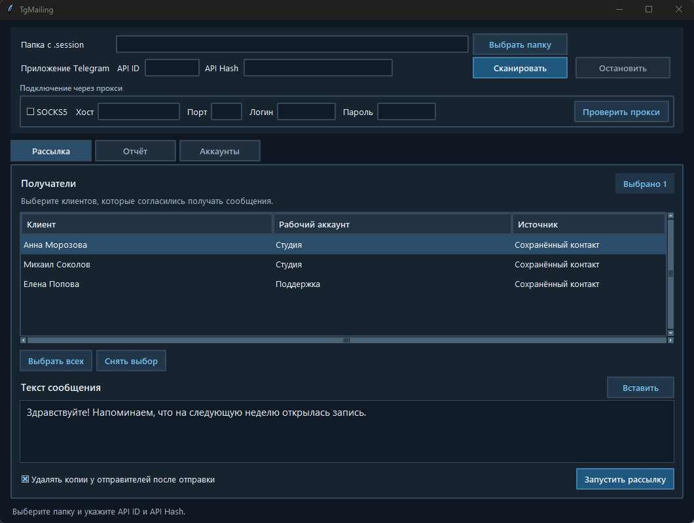

# TgMailing

Локальное Windows-приложение для ручной отправки сообщений существующим клиентам, которые согласились получать такие сообщения. Приложение использует Telegram API.

## Возможности

- Загрузка авторизованных сессий Telethon из папки. Список кандидатов формируется из сохранённых контактов каждого аккаунта.
- Ручной выбор получателей, предварительный просмотр текста и подтверждение отправки.
- Последовательная очередь с остановкой и продолжением. Паузы, которые требует Telegram, сохраняются после перезапуска.
- SOCKS5 с опциональной авторизацией и проверкой подключения к Telegram перед отправкой.
- Опциональное удаление отправленного сообщения только у отправителя. Повторное удаление доступно отдельно.
- Отчёт по аккаунтам и получателям с экспортом в CSV.

## Запуск в Windows

1. Скачайте **TgMailing.exe** со страницы [релизов](https://github.com/prikopov/TgMailing/releases) и запустите его. Для готовой сборки Python не требуется.
2. Получите собственные **API ID** и **API Hash** в разделе **API development tools** на [my.telegram.org](https://my.telegram.org).
3. Выберите папку с авторизованными файлами Telethon `.session` своих рабочих аккаунтов и укажите данные приложения Telegram API.
4. Если нужен прокси, включите SOCKS5, укажите хост, порт и данные авторизации при необходимости. Нажмите **Проверить прокси**.
5. Нажмите **Сканировать**. Проверьте сводку на вкладке **Аккаунты**, а на вкладке **Рассылка** выберите клиентов, которые ожидают сообщение.
6. Введите текст или нажмите **Вставить**. Удаление копий у отправителей включено по умолчанию, галочку можно снять. Нажмите **Запустить рассылку**. Проверьте список и текст в окне подтверждения.
7. Откройте вкладку **Отчёт**, чтобы посмотреть результаты, экспортировать CSV или продолжить остановленную очередь.

Для отбора достаточно, чтобы контакт был сохранён в Telegram на рабочем аккаунте. На вкладке **Аккаунты** показано, сколько контактов вернул Telegram и сколько доступны в программе. Контакты, сохранённые на нескольких аккаунтах, показываются один раз.

Статус «Отправлено» означает, что Telegram подтвердил отправку. При неизвестном результате проверьте чат в Telegram вручную перед повтором. Если Telegram требует ожидания, продолжите очередь после указанного срока.

Рабочая база хранится локально в `%LOCALAPPDATA%\ClientMailTG\campaigns.sqlite3`. Файлы `.session` дают доступ к аккаунтам. Храните их у себя и не публикуйте сессии, API Hash, пароли прокси, отчёты или рабочую базу.

## Запуск из исходников

Понадобится Python 3.14 для Windows с Tcl/Tk. Команды для PowerShell:

~~~powershell
python -m venv .venv
.\.venv\Scripts\python.exe -m pip install -r requirements.txt
.\.venv\Scripts\python.exe app.py
~~~

Для сборки готового файла:

~~~powershell
.\.venv\Scripts\python.exe -m pip install pyinstaller==6.22.3
.\.venv\Scripts\python.exe -m PyInstaller --onefile --windowed --hidden-import python_socks.async_.asyncio --name TgMailing app.py
~~~

Готовый файл появится в `dist\TgMailing.exe`.

## Допустимое использование

Запрещено использовать TgMailing для спама, мошенничества, фишинга, незаконной рассылки, обработки данных без законного основания и других противоправных действий. Используйте только аккаунты, которыми вы уполномочены управлять, и отправляйте сообщения людям, которые согласились их получать. Взаимный контакт или переписка в прошлом сами по себе не означают согласия на рассылку.

Пользователь отвечает за список получателей, содержание сообщений и соблюдение применимого законодательства, требований к защите персональных данных и [условий Telegram API](https://core.telegram.org/api/terms). Уважайте отказ от дальнейших сообщений и ограничения Telegram. Программа предоставляется «как есть» и не гарантирует доставку или отсутствие ограничений аккаунта.
